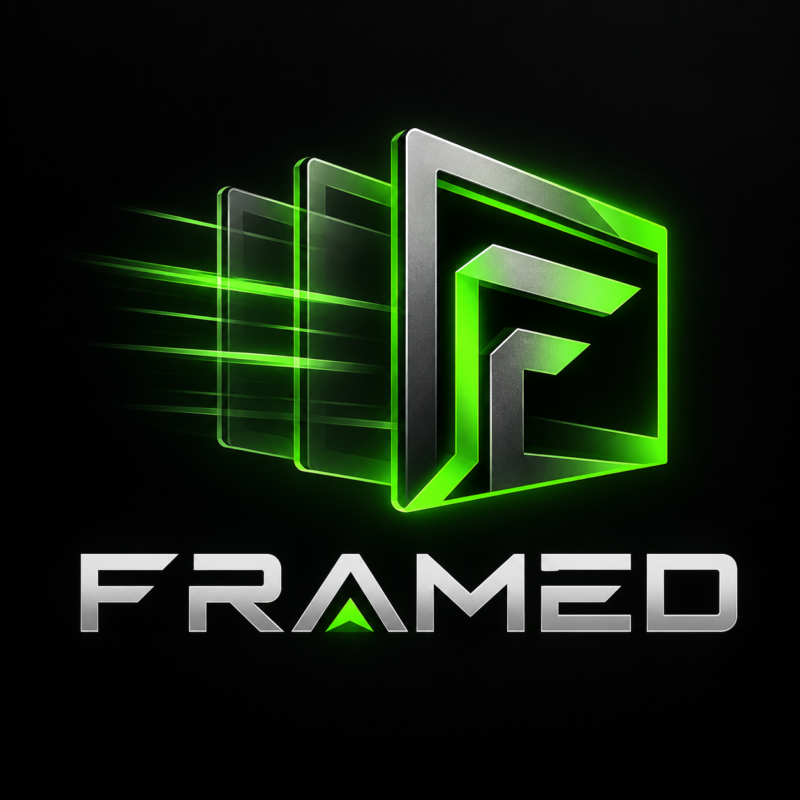
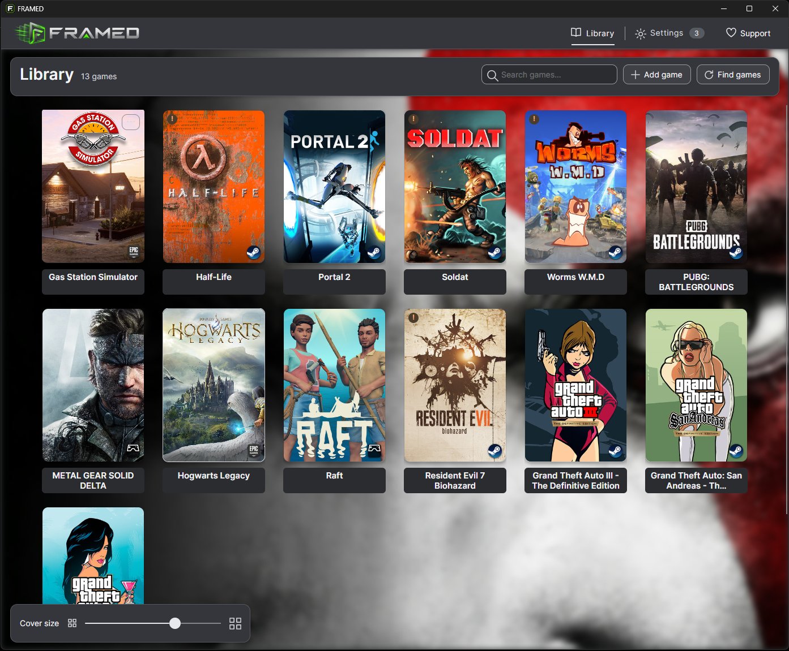
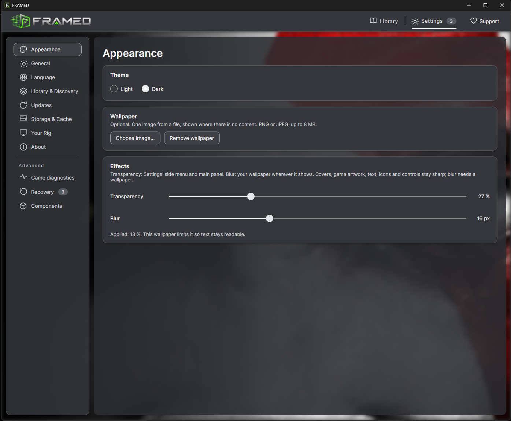
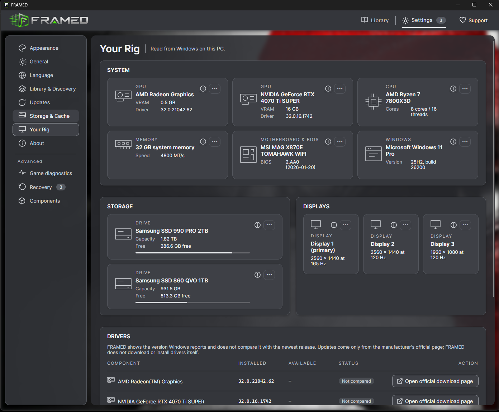
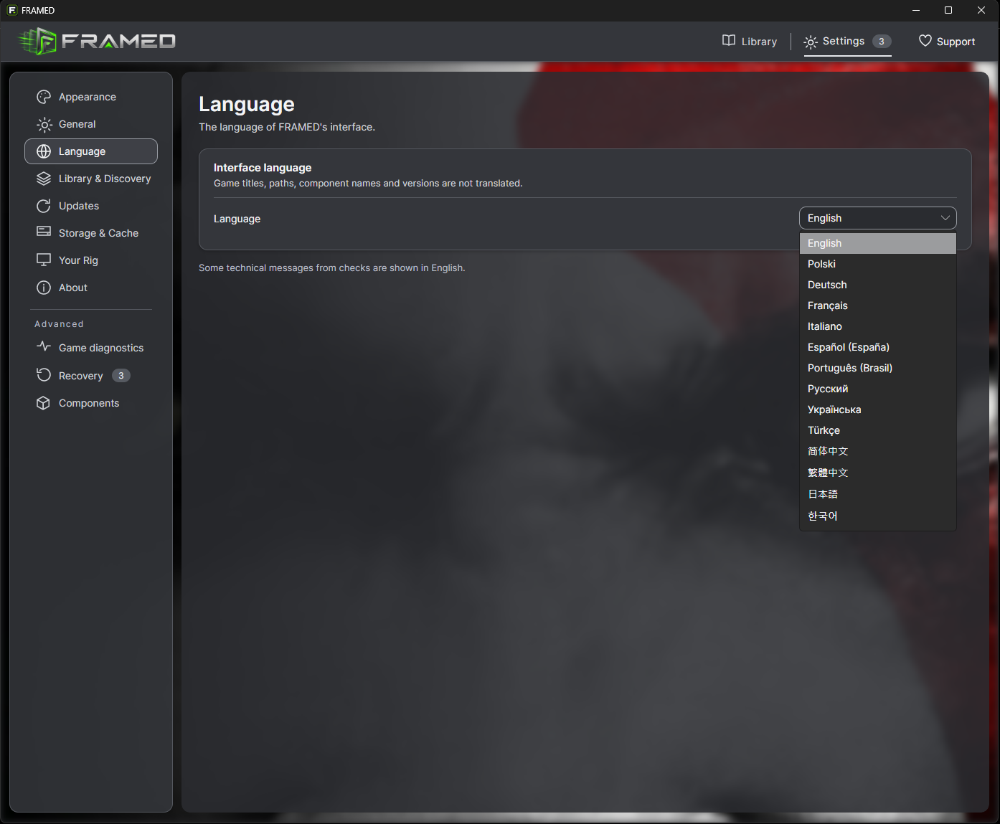
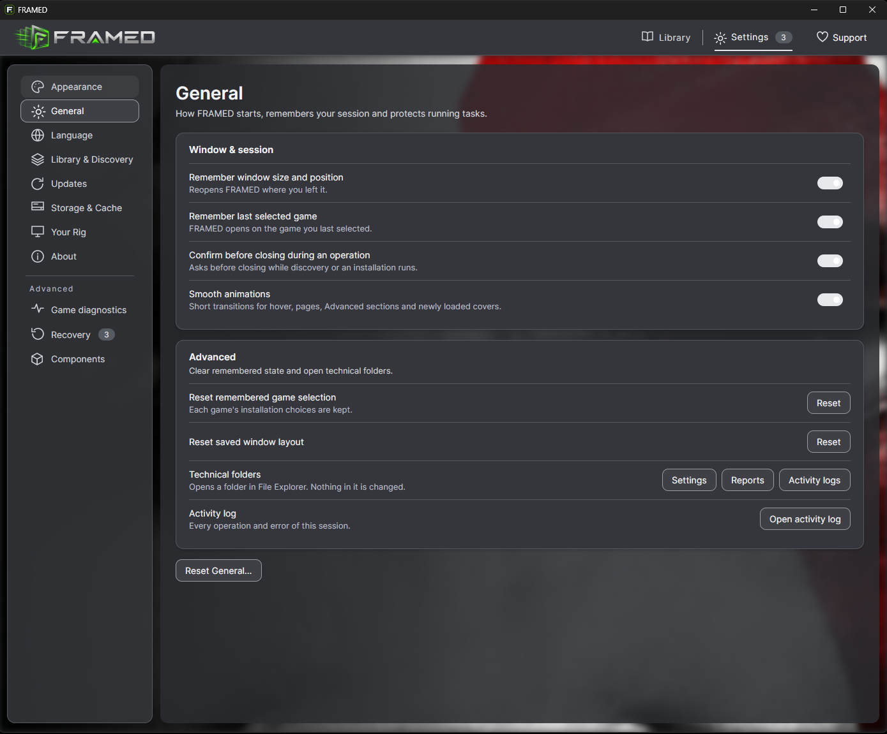
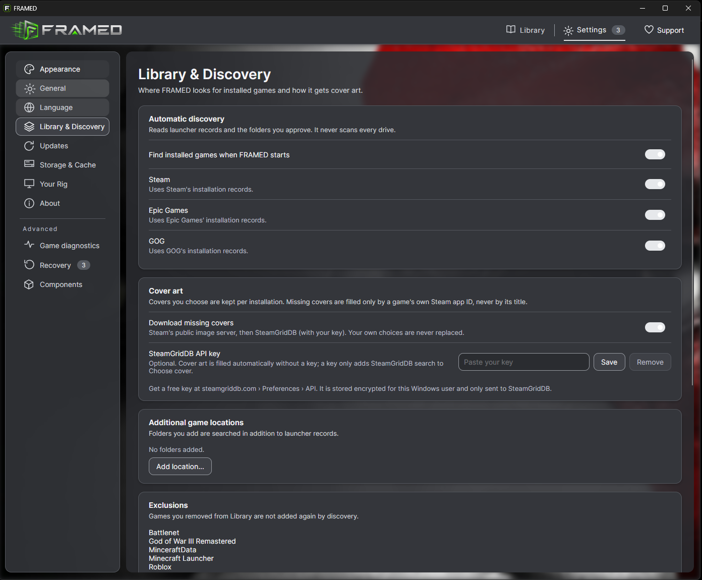
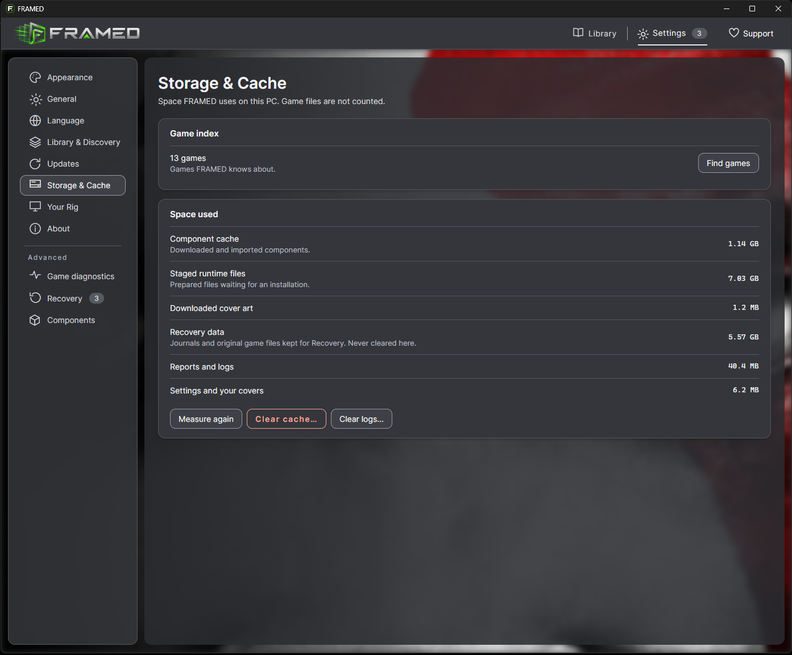

<p align="center">
  
</p>

# FRAMED

**DLSS 5 Neural Rendering and Frame Generation setup management by Rainborne Labs.**

[**Download public alpha**](https://github.com/Rainborne-Labs/FRAMED-Releases/releases/tag/v0.19.1-alpha.14) · [Report a problem](https://github.com/Rainborne-Labs/FRAMED-Releases/issues/new/choose)

FRAMED is a Windows desktop application by **Rainborne Labs**. It finds your PC games and analyses each game's own files (read-only). It installs and removes NVIDIA **Neural Rendering (NR)** and **Multi-Frame Generation (MFG)** setups through community components such as OptiScaler and ReShade add-ons. Every installation is one transaction with backups of the files it replaces, and **Settings › Recovery** can roll it back.

This repository hosts the **binary releases**, release notes, checksums and issue reporting for FRAMED. The source code of FRAMED is not published.

> **Experimental alpha.** FRAMED is alpha software. It changes files in game folders when you ask it to. Use the modifications offline or in single-player only. Online services and anti-cheat software can detect modified game files and penalise accounts, including permanent bans.

## Screenshots

Interface previews from FRAMED alpha builds. Click an image to view it at full size.

### Library

[](assets/screenshots/library.webp)

| Appearance | Your Rig |
| --- | --- |
| [](assets/screenshots/appearance.webp) | [](assets/screenshots/your-rig.webp) |

<details>
<summary>More settings screenshots</summary>

### Interface language

[](assets/screenshots/languages.webp)

### General

[](assets/screenshots/general.webp)

### Library & Discovery

[](assets/screenshots/library-discovery.webp)

### Storage & Cache

[](assets/screenshots/storage-cache.webp)

</details>

## Status

- **Alpha:** behaviour, settings and supported routes can change between releases. Expect bugs.
- **Installation status:** “Installed” confirms that the required files are in place. It does not by itself confirm that Neural Rendering is running or that MFG is presenting generated frames. In-game operation must be checked separately.
- **Translations:** English and Polish are the reference languages. The other 12 interface languages (Deutsch, Français, Italiano, Español, Português (Brasil), Русский, Українська, Türkçe, 简体中文, 繁體中文, 日本語, 한국어) are machine-assisted and have not been reviewed by native speakers. Some technical messages stay in English.

## Requirements

- Windows 10 or Windows 11, 64-bit (x64).
- About 250 MB of free space for the unpacked application, plus space for downloaded components and backups.
- The NR/MFG installation methods documented for alpha.14 require an NVIDIA GeForce RTX GPU and a compatible NVIDIA driver; see the feature-specific requirements below. These GPU restrictions concern the graphics modifications, not the Library, Settings or hardware-information features.
- **AMD and Intel processors are not excluded.** For example, an AMD Ryzen processor paired with a supported NVIDIA RTX GPU is not excluded by these GPU requirements.
- No .NET installation is needed. The runtime is included. No administrator rights are needed.

## Download and run

1. Open [Releases](https://github.com/Rainborne-Labs/FRAMED-Releases/releases) and download `FRAMED_<version>.zip`.
2. Optional: check the archive against the SHA-256 published with the release:
   ```powershell
   Get-FileHash .\FRAMED_<version>.zip -Algorithm SHA256
   ```
3. Unpack the **whole** ZIP to a folder on a local drive, for example `C:\Games\Tools\FRAMED`. Do not run it from inside the ZIP.
4. Start `Framed.exe`. Read and accept the risk notice.
5. `FIRST-RUN.txt` in the folder explains the first steps (English and Polish).

FRAMED keeps its data (library, settings, installation records, component cache, backups) in `%LOCALAPPDATA%\Framed`. Deleting the application folder does not remove installations from games. Uninstall them in FRAMED first, or use Settings › Recovery.

The executable is not code-signed. Windows SmartScreen may warn on first start. Download FRAMED only from https://github.com/Rainborne-Labs/FRAMED-Releases/releases.

## Supported configurations (alpha)

FRAMED decides the installation route from the game's own files. These are the routes that exist, not a guarantee that a game works:

| Feature | Route | Requirements |
| --- | --- | --- |
| Neural Rendering | OptiScaler | x64 game; Direct3D 12, Direct3D 11 (through the DLSS bridge) or Vulkan (experimental upstream); the game's own DLSS, FSR or XeSS input; RTX 20, 30, 40 or 50 (on RTX 20/30 the model is much heavier) |
| Neural Rendering | ReShade + NR Nexus | x64 Direct3D 12 (Upscaled hook) or x64 Direct3D 11 (Present hook, experimental); a local NVIDIA NR runtime (`nvngx_dlssnr.dll` 310.9.16.0 or 310.8.2.0) that you already have. FRAMED never downloads or distributes it. |
| Multi-Frame Generation | RenoDX MFG Unlock add-on | RTX 40 only, on the game's own DLSS Frame Generation; Direct3D 12 or Vulkan (experimental upstream). RTX 50 uses the game's own setting. FRAMED does not install MFG on RTX 20/30. |

### GPU compatibility in alpha.14

| Hardware / feature | Scope of this release |
| --- | --- |
| AMD or Intel CPU | The processor brand does not determine NR/MFG eligibility. Graphics-card and game requirements still apply. |
| NVIDIA RTX GPU — Neural Rendering | See the NR methods and requirements above. A listed method is not a guarantee of in-game compatibility. |
| NVIDIA RTX GPU — MFG | FRAMED's MFG installation method targets RTX 40. RTX 50 uses the game's own supported setting; FRAMED does not install MFG on RTX 20/30. |
| AMD Radeon or Intel graphics — NR/MFG | No supported NR/MFG installation method is documented for these GPUs in alpha.14. This is not a claim that the FRAMED application itself cannot run on those systems. |

Alternative frame-generation methods for AMD/Intel GPUs are not advertised as supported in this release. Their availability in other tools does not establish support in FRAMED.

### Other limitations

- 32-bit games, Direct3D 9/10 and OpenGL (no NR route).
- Games with anti-cheat: FRAMED warns and asks for confirmation. Never use the modifications online.
- NVIDIA driver support for NR (NGX) cannot be checked before the game runs.
- Production MultiPass is blocked (component rights and compatibility are not approved).
- The routes above have been tested on synthetic data. FRAMED's tests do not run real games. Results in real games depend on the game, GPU, driver and component versions.

## Components and network use

The FRAMED package does **not** contain OptiScaler, ReShade, add-ons, NVIDIA runtimes or AI models. When you choose them, FRAMED downloads components from their publishers (for example GitHub release pages and reshade.me) and checks each file's size and SHA-256. You can also import a file you already have. Each component keeps its own licence. Settings › About lists them with their authors and licence sources.

FRAMED has **no telemetry** and sends no usage data. It connects to the network only for:

- **Update checks:** GitHub's release API for this repository. FRAMED only tells you that a newer release exists and links to it; it never downloads or installs itself. Alpha builds follow pre-releases by default (Settings › Updates › Update channel). Checks can be turned off in Settings › Updates.
- **Component downloads:** only when you choose a component.
- **Cover art:** Steam's public image server and GOG's game database. SteamGridDB is used only if you enter your own API key. Can be turned off in Settings › Library & Discovery › Cover art.

## Reporting problems

Use [Issues](https://github.com/Rainborne-Labs/FRAMED-Releases/issues/new/choose):

- **Application bug:** crashes, wrong UI behaviour, discovery, installation records, Recovery.
- **NR / FG problem:** Neural Rendering or Frame Generation does not work, or behaves wrongly, in a specific game.

FRAMED writes logs and reports to `%LOCALAPPDATA%\Framed`. **Before you attach a log or report, remove personal data**: your Windows user name in paths, other user names, e-mail addresses, licence or API keys, and anything else you do not want public.

## Licence

FRAMED is free to download, use and test under the [FRAMED Freeware Licence](LICENSE.txt). You may publish reviews, screenshots and videos of it. The licence does not allow modifying, selling or redistributing FRAMED. Link to https://github.com/Rainborne-Labs/FRAMED-Releases/releases instead of re-hosting the ZIP. Rights given by law and the licences of third-party parts are not affected. Third-party licence texts are in the `ThirdPartyNotices` folder of every release. The same licence and notice files of the current release are in the [`notices`](notices) folder of this repository, including the plain-text source of the GPL-3.0 OptiScaler.ini templates that FRAMED embeds (`notices/ThirdPartyNotices/OptiScaler-ini`).

Releases up to and including 0.19.1-alpha.11 were distributed with the MIT License. Copies of those releases keep the permissions they were distributed with.

NVIDIA, GeForce RTX and DLSS are trademarks of NVIDIA Corporation. Steam, Epic Games and GOG are trademarks of their owners. FRAMED is not affiliated with or endorsed by NVIDIA, any component author or any game publisher.

## Support development

FRAMED's public releases are free to download. If you find it useful, you can support development through [Ko-fi](https://ko-fi.com/rainborne_labs) or [Patreon](https://www.patreon.com/c/rainborne_labs).

Support is entirely optional. It helps cover development costs and does not unlock exclusive application features or priority support.
